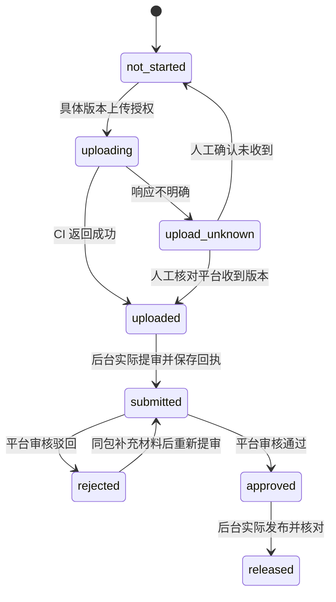

# 微信小游戏发行手册

## 能力边界

Cocos 构建得到微信小游戏项目；`miniprogram-ci` 可以预览和上传开发版本。这里没有实现未核实的提审/发布 API。默认由你在微信后台完成提审和正式发布，控制器记录带证据的真实状态。

**H5 是候选验收，不等于向外上传、提审或发布的授权。** 使用下面的具体版本命令才授权本次上传。若你日后明确预授权一套发布策略，可以按该策略配置新的适配器；本工具不会自行扩大授权。

## 首次账号与环境准备

- 注册并选择真实主体，提供 AppID；本人完成实名、扫码、管理员绑定等动作。
- 核对当前账号允许的游戏类目、备案、所需资质、隐私声明和商业化能力。要求应从你的真实后台和现行官方材料确认，不能引用过时博文替代。
- 安装/登录 Cocos 与微信开发者工具；在编辑器中导出对应版本构建配置。Cocos CLI 需要可用的桌面环境。
- 只有需要自动上传时才配置代码上传密钥和 IP 策略。密钥放在项目目录之外，按官方方式保管，不发给模型。
- 可先完成无后端、无广告的本地玩法验证；不需要为了原型先开通所有商业功能。

本次未登录你的微信后台或核查具体资质，未创建账号、购买服务、上传代码、提交审核或发布。

## 构建适配器

在 `workflow.local.json` 的 `tools.cocosExecutable` 指定已安装编辑器的准确路径。使用编辑器导出的构建 JSON：

```powershell
node tools/cocos-build.mjs game/config/build-wechat.json game/build/wechatgame
```

路径相对 `game-workspace`。适配器使用 Cocos 3.8 官方约定的成功退出码 **36**，并检查 `game.js`、`game.json`、`project.config.json`。日志在 `game-workspace/deliverables/logs/cocos-build.log`。这不是现在已执行的真实构建；缺少编辑器/工程时会失败。

QA 冻结整个待测包的文件清单和 SHA256。H4 真机记录与该包绑定，H5 继续使用同一个包。正式构建若产生不同字节，必须重新做相关验收，不能仅沿用同样的版本号。

## 上传开发版本

H5 完成后先生成可审阅计划：

```powershell
node tools/release.mjs plan
```

首次使用上传工具才安装依赖，安装后保存准确版本与 lockfile：

```powershell
npm install --save-dev --save-exact miniprogram-ci
```

在执行上传的终端设置 `WECHAT_PRIVATE_KEY_PATH`，指向项目外私钥。不要把私钥内容写入命令、仓库或提示。然后明确授权候选版本：

```powershell
node tools/release.mjs upload --authorize-version 0.1.0
```

版本必须与 H5 候选相同。脚本会校验批准是否有效、材料是否变更、AppID/类型是否匹配，以及发行包全部文件的哈希。上传私钥不会传给开发子 Agent。

上传成功后记录 `uploaded`。超时或响应不明确记为 `upload_unknown`，不会自动重复上传；先检查平台是否已经收到该版本，再导入回执。该适配器尚未用你的真实 AppID/密钥进行联调。

## 提审、审核和发布



用 `templates/platform-receipt.example.json` 准备真实回执，证据放到 `game-workspace/evidence/platform/`。记录具体版本、发行清单哈希、平台记录号、时间、操作人和截图/日志路径：

```powershell
node tools/release.mjs record submission-receipt.json
node tools/release.mjs record review-approved-receipt.json
node tools/release.mjs record published-receipt.json
```

`record` 只是记录你的平台操作事实，不会调用审核或发布接口，记录来源为 `human_attested`。不能从 uploaded 直接跳到 released。若选择在微信开发者工具手工上传，可从 not_started 导入 uploaded 回执。

审核驳回只涉及材料文字且包不变时，保留同候选并按平台要求重新提交。需要改代码、素材、隐私行为或构建包时，退回相应研发/QA 阶段，重新 H4/H5。新候选有自己的发布状态，旧版本历史保留，不继承旧版 approved/released。

## 上线后与持续自动化

第一轮上线后，按运营方案接入真实异常、首局完成和复玩数据。当前没有你的分析服务账号或数据接口，因此交付的是事件口径和故障预案的生成流程，不宣称已有 24 小时监控。

对接有效 API 后可以自动抓取数据、分析异常、生成修复分支和候选；生产环境改动、投放付费、支付开通或改变数据采集范围仍按你的授权边界执行。系统/账号限额、机器离线和平台审核等待不是 AI 能保证消除的时间。
