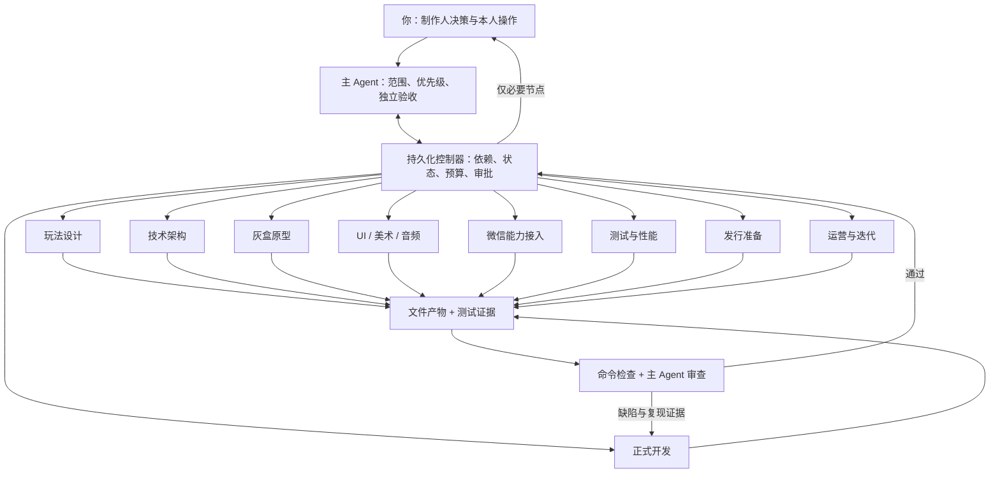

# 微信小游戏：单人 AI 工作流设计与运行手册

## 适用范围与成功标准

一个人可以承担制作人和最终决策者，让 AI 完成大量调研、文档、资产、编码、测试和发行准备。适合第一款小体量 2D 休闲游戏。复杂多人对战、重度内容生产和持续运营会显著增加成本；游戏好玩、商业成功和平台审核通过，不能由自动化保证。

这套流程的成功标准是：每个阶段有真实产物、有可检查证据、有独立主 Agent 审查；正常工作连续执行，只在主观判断、缺少真实资料、平台授权和无法自动消除的异常处交给人。提交一个 JSON `done` 不是完成标准。

本项目已经实现编排机制、角色任务书、演示和测试。实际 Cocos 游戏、业务测试脚本和素材由后续真实阶段生成；它们不是现在已经存在的游戏。自动化覆盖的前提是工具已安装、账号可用、模型有额度、机器在线。工具能力不足时会明确阻塞，不会用模拟结果越过门禁。

## 技术选择

| 层 | 选择 | 适合本项目的原因 |
|---|---|---|
| 主控 | Node.js 持久状态机 + 制作人 Agent | 状态不丢、便于测试，模型只做需要判断的工作 |
| Agent 执行 | ZCode 本地 Harness（桌面版内置 CLI，无头 `--prompt` 模式，任务书经 `--attach` 注入） | 工作者 yolo 可写、审查者 plan 只读；结构化 JSON 结果经控制器校验 |
| 模型服务 | 火山引擎 Coding Plan（Anthropic 兼容协议），固定 `glm-5.3-flash` | 使用用户已有套餐；密钥经 `ARK_API_KEY` 环境变量注入 |
| 游戏引擎 | Cocos Creator 3.8 LTS 系列 | 官方提供微信小游戏适配、编辑器、资源系统和构建路径 |
| 游戏代码 | TypeScript；核心规则纯逻辑 | 可独立测试，微信适配不会污染规则 |
| 包管理 | npm + 精确版本 + lockfile | 本机可用；减少工具数量，避免依赖漂移 |
| 测试 | Node test/Vitest + Playwright + 微信工具/真机 | 分层测试；规则、Web 与微信平台各自取证 |
| 美术 | 原创程序美术为底座；AI 位图按能力补充 | 能离线自动生成，便于统一风格和控制包体 |
| 后端 | 首版无后端，确需时评审 CloudBase | 减少凭据、运维、费用和隐私面 |
| 发布 | 官方 miniprogram-ci 上传 + 微信后台审核/发布 | 有依据的能力边界，避免把上传误称上线 |
| 版本管理 | 本地 Git，小批次变更；远程仓库按需 | 可回看改动，单人先不引入复杂流水线服务 |

3.8 系列的具体补丁版本在架构阶段验证后锁定；不是要求所有机器随时升级到“最新”。控制器已在本机 Node 20.20.0 上验证，运行兼容 Node ≥20；正式生产机器应采用仍受支持的 Node 版本，并与工具依赖一起锁定。此处不将本机现有旧版本当作长期升级建议。

子 Agent 以 ZCode CLI 无头模式运行（`ELECTRON_RUN_AS_NODE` 启动 `resources/glm/zcode.cjs`），工作目录锁定为 game-workspace；审查者使用 plan 只读模式。控制器配置供应商 `ark`、模型 `glm-5.3-flash`，密钥经环境变量注入。子进程会移除 `OPENAI_API_KEY` 与 `CODEX_API_KEY`，缺少 `ARK_API_KEY` 就停止，因此不会回退消耗其他额度。已知边界：ZCode 无头模式没有文件系统级沙箱，工作者写入范围依赖任务书约束，并由控制器的产物指纹校验与只读审查兜底。

为什么不先上多套 Agent 框架、消息队列和 Kubernetes：这个范围内，顺序依赖与一个写入者已经足够；可测试的状态机能解决持久进度、重试和门禁。未来有多项目、远程工人或团队并发再扩展。这里是任务级角色协作，默认顺序执行；不是声称已有并发集群。

## 主 Agent 与子 Agent

主 Agent（`agents/producer.md`）以只读审查方式把控阶段结果，决定通过、修复、退回上游或请求人工。控制器落实决定，并施加硬性条件。专业子 Agent 负责实际产出；每次得到角色说明、当前阶段、既有产物、失败反馈和工具约束。



角色不是各自聊天后互相说“已完成”。交接单位是工作区中的文件。默认一次仅一个写入者，审查者只读，避免多个 Agent 同时破坏场景和 meta 引用。子进程关闭原生递归多 Agent 调度，由本控制器统一派角色，避免一个子 Agent 又自行扩成未计数的团队。后续如需并行，先引入独立 Git worktree 和明确集成责任，再放宽单写者约束。

## 完整阶段与交接

| 阶段 | 自动工作 | 主要产物 | 通过条件 / 下一步 |
|---|---|---|---|
| 准备 | 探测工具、读取简报、梳理账号缺口 | doctor 输出、brief | 缺账号不阻止调研；依赖账号时才请求 |
| 01 选题 | 竞品取证、3 个候选、规则和 MVP | 01-concept、game-design | 主 Agent 审查；H1 确认推荐方向 |
| 02 方案 | 技术锁定、模块边界、任务拆分 | architecture、backlog、toolchain | 每个任务有验收；必要工具可验证 |
| 03 原型 | 核心闭环、灰盒、规则测试、预览 | 可运行工程、prototype-test | 实际检查通过；H2 试玩认可 |
| 04 视觉 | UI 样张、风格、资产与授权记录 | ui-preview.png、asset-manifest | 可视资产真实存在；H3 视觉确认 |
| 05 开发 | 正式规则、UI、声音、存档、异常 | feature-matrix、正式工程 | MVP 条目全部覆盖；自动测试通过 |
| 06 接入 | 生命周期、存储、音频、能力开关 | platform-matrix、微信构建 | 必需能力已验证，未用能力 disabled |
| 07 测试 | 回归、包体、性能、真机测试包 | qa-results、device-test-plan | 自动层通过；H4 导入真机证据 |
| 08 发行 | 冻结候选、隐私/资质、截图与材料 | release-manifest、compliance、listing | 同一候选哈希；H5 验收 |
| 09 运营准备 | 事件口径、故障预案、迭代假设 | metrics-plan、incident-runbook | 有可执行方案；无数据不编造结论 |
| 平台发行 | 授权后上传；记录审核与上线回执 | 上传记录、审核记录、发布记录 | 以真实平台状态确认上线 |
| 上线后 | 接入真实指标后分析，提出小步实验 | 真实数据报告、新 backlog | 变更重新走开发、测试、发行链 |

账号注册、实名、备案、主体资质与经营能力核验应从选题阶段启动，与研发并行准备。它们不一定能用统一 API 自动完成，用户提供真实事实后继续。不能因“个人开发”直接推断任何资质必然免除。

每个阶段的具体任务、输出路径和验收细节在 `agents/`，机器可读依赖在 `workflow/stages.json`。**未来游戏的 `verify.mjs` 是由开发 Agent 实现、主 Agent 阅读检查、QA 独立补充的业务测试入口；控制器不能仅靠一个退出码证明游戏正确。**

## 人工节点如何工作

正常开发仅 H1 方向、H2 试玩、H3 视觉、H4 真机、H5 发行候选五个决策点。分别安排是为了在投入下一阶段前尽早纠偏。工具已安装、账号资料已补齐时，不再逐命令询问。

每次到节点先产出可打开的结果与具体问题，保存完整内容指纹，再暂停。你可以通过这个对话告诉主 Agent 同意或修改，也可以使用 CLI。批准只对当前材料有效；改变玩法、代码、包、隐私或资质材料后，必须从受影响阶段重新验收。

```powershell
npm run workflow -- approve H2 --note "已试玩三局，认可操作和节奏"
npm run workflow -- reject --from 03-prototype --note "拖拽反馈滞后，修正后重新试玩"
```

H4 需在 `game-workspace/evidence/device/` 放真实日志或录像，然后根据 `templates/device-evidence.example.json` 填一份记录。候选版本和哈希在 `.workflow/state.json` 的 `pendingGate.candidate` 中。

```powershell
npm run workflow -- evidence device-evidence.json
npm run workflow -- approve H4 --note "Android 和 iOS 真机均完成清单，无阻断问题"
```

这些是人工提交的测试事实，系统能校验结构、附件、版本与包指纹，不能证明用户录像里的体验一定合格。制作人仍要实际检查。模板不是证据。

临时 HITL 只用于：账号扫码或本人认证；当前平台资质不明确；实际工具/素材能力缺失；新增支出或外部发布授权；反复失败后的设计取舍。每次必须附当前产物、失败证据、推荐处理和最小解锁动作。

## 自动验收、返工与恢复

1. 子 Agent 写产物和结构化结果。
2. 控制器校验路径、文件存在性、JSON/PNG 有效性，拒绝真实流程中的模拟数据。
3. 控制器实际执行登记的验证命令，保存退出码与 stdout/stderr；非零或超时失败。
4. 制作人 Agent 审查控制器直接读取的文件快照、哈希与检查日志，判断是否满足目标、测试是否有意义；需要的额外文件再只读获取。上下文装不下的文件会列为 omitted，不假装已审查。UI 阶段实际 PNG 附给审查模型。
5. 缺陷回给当前子 Agent 自动修复。上游方案错时回退对应阶段，并撤销其后审批。
6. 通过后进入下一阶段，或创建人工节点；H4 与 H5 额外校验候选包身份。

默认每阶段最多 3 次尝试（首轮 + 2 次修复），每次运行最多 24 次 Agent 调用、120 分钟，每个调用最多 20 分钟。跨阶段自动返工最多 2 次。额度不足或达到限额会暂停，不会自动无限重启。

CLI 能提供 token 用量时，控制器在调用结束后累计观察值；缺数据记为 unknown/null。token 阈值不是单次请求硬上限，也不是人民币账单。当前外部服务新增支出预算为 0；模型实际消耗受你的账号额度/付费方式控制。

`.workflow/state.json` 保存进度；`events.jsonl` 为事件记录；`runs/` 保存逐次提示、结构化结果与检查日志；`STATUS.md` 可直接阅读。常驻模式并不替代操作系统服务：电脑需在线、终端进程需存活。

异常退出后先检测遗留写入进程，避免重复写入；已结束的异常任务保留部分产物并暂停。处理阻塞后：

```powershell
npm run workflow -- retry --note "已解决错误并检查部分产物"
```

规则或暂停期间的产物变化，不能用 retry 刷新指纹并保留旧批准；需要 `reject --from` 明确返工。发行外部动作如果结果未知，先核对后台，不能自动重试，以免重复操作。

该控制器用于可信本机上的开发协作；角色约束、CLI 沙箱和文件指纹不是恶意代码隔离系统。需要无人值守运行不可信依赖时，应另用隔离构建环境、最小凭据和专用账号。不要把上传私钥放进游戏工程或 Agent 提示。

## 质量标准建议

以下是首版项目目标，不冒称微信统一强制限额：完整胜负与存档闭环、零已知阻断缺陷；目标机 60 FPS，低端至少 30 FPS；首屏交互目标 3 秒；主包预算不超过 4 MB；正式值按设备、网络和当前微信校验确定。性能必须有测量口径和原始记录。

Web 能证明规则和部分 UI；微信开发者工具能验证部分平台行为；真正手机上的生命周期、音频、广告、网络和性能还需真机。只在相关能力确已启用时要求广告/登录测试，未启用能力明确关闭。

建议以一次小型纵向切片开始：首局可玩 → 确认乐趣 → 一套正式皮肤 → 微信包 → 双端真机 → 提审。先用真实候选验证这条链，之后扩内容，能最早暴露引擎、账号和平台问题。

## 相对参考站补充的内容

用户先后提供的两个参考站都采用先灰盒再美术、最小 MVP、开发与资质双线并行的路线。新页面还提供服务器选择器、时间/成本估算、AI 岗位提示词、上线清单、冷启动建议和《叠叠高》试玩。本工作流吸收了服务器决策表、双线时间表、胶囊安全区、自审材料、素材版权和冷启动草案等可执行要点。

参考站属于交互指南，不是现成 Agent 执行器。本实现补充了实际角色调用、结构化交接、独立检查、带上限的返工、持久进度、审批指纹、真机包绑定与发布状态记录。页面中的费用、收益、审核天数及主体资质结论只作为待核实线索；真实发行门禁仍以当前官方材料和目标账号后台为准。

当前没有自动接入用户未提供的运营数据，也没有安装系统后台服务。审核/发布 API 的账号能力尚未核实，因此默认走真实后台人工节点。未来接入已验证接口后，可把这些平台动作移入同一状态机，但仍需要明确的版本授权和平台回执。

资料与核实边界见 [SOURCES.md](SOURCES.md)。
